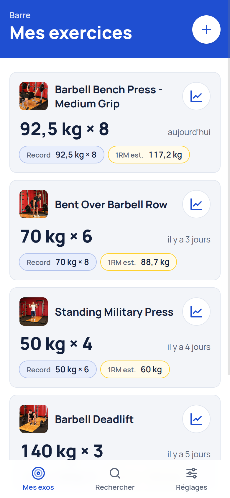
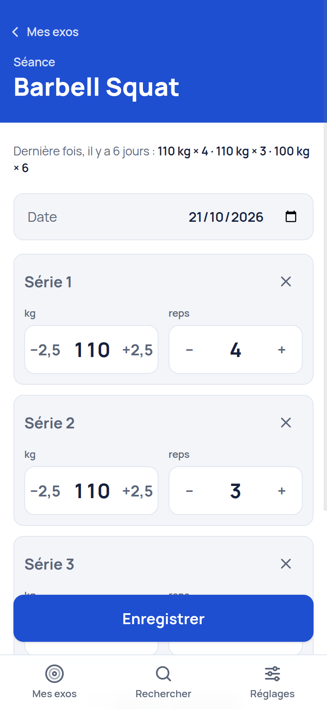
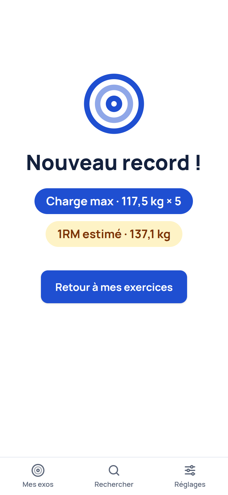
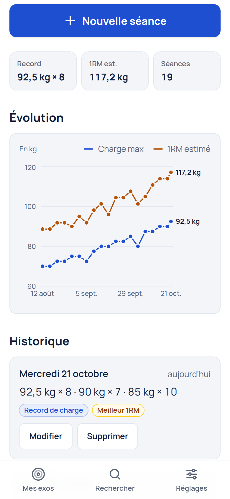
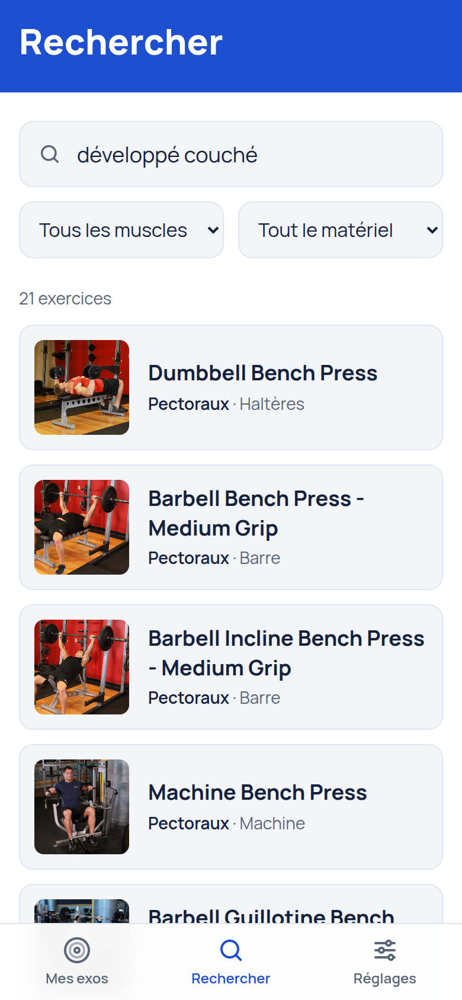

# Barre — suivi de charges en musculation

Application web mobile-first pour suivre sa progression exercice par exercice.
À la salle, on ouvre l’app, on voit immédiatement ce qu’on a soulevé la dernière
fois, et on enregistre sa séance en quelques pouces.

**Démo :** [weight-tracking-tau.vercel.app](https://weight-tracking-tau.vercel.app) · données stockées uniquement dans le navigateur (aucun compte). Pour explorer sans rien saisir : bouton « Essayer avec des données de démo » sur l’accueil.

<p align="center">
  
  
  
</p>
<p align="center">
  
  
</p>

## Fonctionnalités

- **Recherche d’exercices** dans une base libre de plus de 870 exercices, avec photos.
  Recherche en français (« développé couché », « soulevé de terre », « tractions »…),
  tolérante aux fautes de frappe, filtrable par muscle et par matériel.
- **Mes exercices** : pour chacun, la dernière performance (« 80 kg × 8 · il y a 3 jours »),
  le record de charge et le meilleur 1RM estimé.
- **Saisie de séance pensée pour une main** : séries pré-remplies avec la dernière séance,
  gros boutons ±2,5 kg / ±1 rep, virgule décimale acceptée, validation en direct.
- **Records automatiques** : record de charge et record de 1RM estimé (formule d’Epley),
  détectés à l’enregistrement et célébrés par une petite animation.
- **Progression** : courbe de la charge max et du 1RM estimé sur une vraie échelle de temps,
  historique modifiable et supprimable.
- **Sauvegarde** : export / import JSON validé, données de démo, effacement complet.
- **Installable et hors ligne (PWA)** : s’ajoute à l’écran d’accueil et fonctionne sans
  réseau au fond de la salle (saisie, historique, graphiques, recherche déjà chargée).
- **Accessibilité** : navigation clavier, focus visible, libellés explicites, annonces
  aux lecteurs d’écran, animations désactivées si « réduire les animations » est actif,
  palette du graphique vérifiée pour le daltonisme.

## Stack

| Besoin     | Choix                                                                                             |
| ---------- | ------------------------------------------------------------------------------------------------- |
| UI         | React 19, TypeScript strict, Vite                                                                 |
| Style      | Tailwind CSS 4 (tokens dans `src/index.css`)                                                      |
| Données    | IndexedDB via Dexie.js + `useLiveQuery`                                                           |
| Recherche  | Fuse.js + dictionnaire de synonymes français                                                      |
| Graphiques | Recharts (chargé à la demande)                                                                    |
| Navigation | React Router                                                                                      |
| Hors ligne | vite-plugin-pwa (Workbox)                                                                         |
| Qualité    | Vitest, React Testing Library, fake-indexeddb, ESLint (`strictTypeChecked`, `jsx-a11y`), Prettier |

## Choix techniques

**IndexedDB comme source de vérité, sans store global.**
Pas de backend pour le MVP : les données vivent dans IndexedDB. `useLiveQuery` (Dexie)
rend les requêtes réactives, chaque écran relit la base et se met à jour seul après une
écriture. Pas de Redux/Zustand : il n’y aurait rien à y mettre.

**Les records sont calculés, jamais stockés.**
Dernière perf, record de charge et meilleur 1RM sont dérivés de l’historique par des
fonctions pures (`src/lib/performance.ts`). Modifier ou supprimer une séance ne peut donc
pas désynchroniser un record. Ces fonctions sont couvertes par des tests unitaires.

**Une interface pour la source d’exercices.**
`ExerciseProvider` isole free-exercise-db : le JSON est téléchargé une fois, normalisé
(validation de forme, URLs d’images absolues) puis mis en cache dans IndexedDB.
Brancher une autre API (wger…) revient à écrire un autre provider.

**Recherche en français sur une base anglaise.**
La requête est normalisée (accents, ponctuation), les expressions françaises sont
traduites (les plus longues d’abord : « rowing barre » avant « barre »), puis Fuse.js
cherche chaque mot en flou. Une courte liste de mouvements classiques remonte en tête,
sinon Fuse favorise les noms courts et le développé couché à la barre finit 18ᵉ.

**Saisie en texte, validée à l’enregistrement.**
Les champs gardent la saisie brute et `parseSet` la valide : `<input type="number">`
gère mal la virgule française et empêche de vider un champ pendant la frappe. Les pas de
±2,5 kg sont arrondis au centième pour éviter les `82,4999…` des flottants.

**Le nom et l’image de l’exercice sont copiés dans `UserExercise`.**
L’accueil s’affiche sans attendre le catalogue (~1 Mo), et un changement de provider ne
casse pas l’historique.

**Import défensif.**
Un fichier importé est une donnée non fiable : `parseBackup` vérifie chaque champ, les
références entre séances et exercices, et les doublons. La restauration se fait dans une
transaction : soit tout est remplacé, soit rien ne change.

**Hors ligne d’abord.**
Les données étant déjà locales (IndexedDB), il restait à rendre l’app elle-même
disponible sans réseau. Le service worker (Workbox via vite-plugin-pwa) précharge tout
le build, y compris l’écran Progression chargé à la demande, et met en cache les polices
et les photos d’exercices au fil de la navigation. Les photos sont demandées en CORS
(`crossOrigin="anonymous"`) : une réponse « opaque » serait comptée ~7 Mo chacune dans
le quota de stockage du navigateur. Les mises à jour sont **proposées** (bandeau
« Nouvelle version disponible ») plutôt qu’appliquées d’office : un rechargement
automatique effacerait une séance en cours de saisie.

**Poids toujours en kg.** Un futur choix kg/lbs ne sera qu’une conversion à l’affichage.

**Thème « Club », en blanc et bleu.** Un bandeau bleu roi en tête de chaque écran
(`PageHeader`), des cartes gris très clair, du texte bleu nuit et la police Manrope.
Les couleurs portent un sens constant : bleu pour l’action et le record de charge,
ambre pour le 1RM estimé (comme sur le graphique), rouge réservé aux erreurs et aux
suppressions. Elles sont définies une seule fois, par rôle (`page`, `card`, `ink`,
`muted`, `brand`…), dans `src/index.css`.

## Architecture

```
src/
├── components/      UI partagée (Stepper, ExerciseImage avec repli, états vides…)
├── db/              schéma Dexie et données de démo
├── features/
│   ├── exercises/   provider free-exercise-db, recherche, fiche exercice
│   ├── tracking/    mes exercices, saisie de séance, progression
│   └── settings/    sauvegarde, démo, à propos
├── hooks/           chargement et cache du catalogue
├── lib/             logique pure et testée : performance, recherche, saisie, sauvegarde, formats
└── types/           modèle de données
```

Modèle de données :

```ts
UserExercise { id, exerciseId, name, image?, addedAt, notes? }
WorkoutEntry { id, userExerciseId, date: 'YYYY-MM-DD', sets: { weight /* kg */, reps }[], note? }
```

## Lancer en local

Prérequis : Node.js 20 ou plus récent.

```bash
npm install
npm run dev        # http://localhost:5173
```

Pour explorer l’app sans saisir de données : **Réglages → Charger les données de démo**
(ou le bouton sur l’accueil vide).

| Script           | Rôle                                                             |
| ---------------- | ---------------------------------------------------------------- |
| `npm run dev`    | serveur de développement                                         |
| `npm run build`  | vérification TypeScript + build de production dans `dist/`       |
| `npm test`       | tests en mode watch                                              |
| `npm run check`  | TypeScript, ESLint et tous les tests (à lancer avant de pousser) |
| `npm run format` | Prettier                                                         |

## Déploiement

Site statique : `npm run build` produit `dist/`.

- **Vercel** : importer le dépôt, aucun réglage. `vercel.json` renvoie toutes les routes
  vers `index.html` pour que React Router fonctionne au rechargement.
- **Netlify** : commande `npm run build`, dossier `dist`, et ajouter un fichier
  `public/_redirects` contenant `/* /index.html 200`.

## Limites connues

- Les données restent dans le navigateur : penser à exporter une sauvegarde.
- Hors ligne, la recherche suppose que le catalogue ait été chargé une première fois en
  ligne ; seules les photos déjà affichées sont en cache (sinon, initiales en repli).
- Le bandeau « Hors ligne » repose sur `navigator.onLine` : il s’affiche en mode avion,
  pas avec un réseau présent mais inutilisable. L’app fonctionne dans les deux cas.
- Les exercices au poids du corps (0 kg) n’ont pas encore de record dédié (en répétitions).
- Les instructions des exercices sont en anglais (celles de la base source).

## Crédits

- Exercices et photos : [free-exercise-db](https://github.com/yuhonas/free-exercise-db)
  de yuhonas, dans le domaine public (Unlicense).
- Polices : [Barlow et Barlow Condensed](https://fonts.google.com/specimen/Barlow)
  de Jeremy Tribby (SIL Open Font License).
- 1RM estimé : formule d’Epley, `poids × (1 + reps / 30)`.
